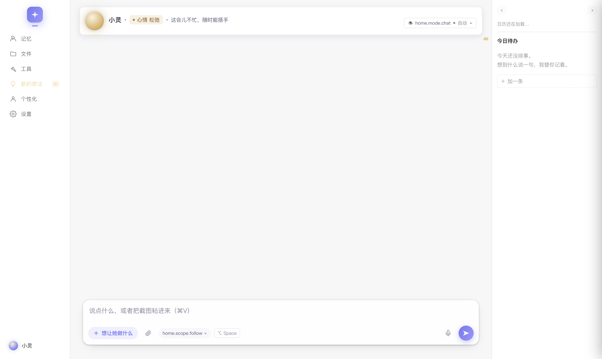
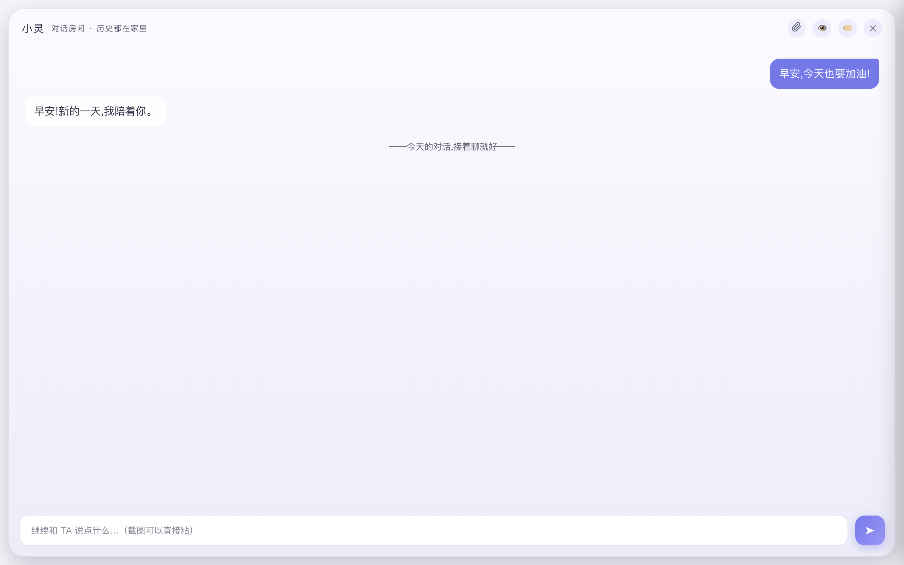

<h1 align="center">灵核 · LHCD</h1>

<p align="center"><strong>跑在自己电脑上的拟人化数字人 · 桌面智能体</strong><br>
Live2D 形象 · 长期记忆 · 人格可验证 · 自研 Agent Harness</p>

<p align="center">中文 | <a href="#english">English</a></p>

---

# 中文

## 这是什么

灵核（LHCD）是一个桌面数字人 App：一个有形象（Live2D）、有记忆、有性格的智能体，住在你的电脑里，帮你做事、陪你相处。

- **数据留在本机**：记忆、会话、快照、审计日志全部在 `~/.lhcd/data`，模型走你自己的 API Key（BYOK）。
- **智能体大脑自研**：`brain` 是一个零运行时依赖的 Agent Harness（TypeScript，约 3 万行），循环 / 工具 / 权限 / 记忆 / 提示词分区全部自持。
- **人格可验证**：`core` 用混合逻辑时钟 + ed25519 签名链给关键事件（出生包、审计动作、审批决定）留证据。

技术形态：Electron 33 桌面端（macOS / Windows）+ TypeScript 智能体大脑 + 可选 PHP 出生链路服务端。**早期开发中**，界面与协议随时演进。

| 家页 | 对话 | 形象端 |
|---|---|---|
|  |  |  |

## 使用说明

### 装一个用（普通用户）

1. 安装包：macOS `.dmg` / Windows `.exe`。**未签名**——macOS 首次打开请右键 → 打开；Windows 会在 SmartScreen 里提示，点「仍要运行」。
2. 首次启动走「出生」向导，然后在设置里填模型 API Key（BYOK：DeepSeek 等 OpenAI 兼容端点均可）。
3. 所有数据在 `~/.lhcd/data`：`sessions/`（会话与事件流）、`memory/`（记忆）、`snapshots/`（回合快照）、`log.jsonl`（审计日志）、`credentials.json`（凭据，0600）。备份这个目录就是备份她。

### 从源码跑（开发者）

前置：Node ≥ 22（开发机为 24.x）+ npm。

```bash
# 1) 装依赖（brain / core / runtime 三个包各自装）
cd brain  && npm install && cd ..
cd core   && npm install && cd ..
cd runtime && npm install        # 会装 Electron 33

# 2) 起桌面端（prestart 会自动把 core/ 与 brain/ 编译到各自的 dist/）
cd runtime && npm start

# 想零成本先逛一圈（模型为 mock，不花 API 钱）：
LHCD_LLM_MOCK=1 npm start
```

常用环境变量：

| 变量 | 作用 |
|---|---|
| `LHCD_DATA_DIR` | 换数据目录（默认：打包态 `~/.lhcd/data`，开发态 `runtime/data`） |
| `LHCD_LLM_MOCK=1` | 注入 mock 模型，全链路零成本 |
| `LHCD_SMOKE=1` | 冒烟隔离（不弹窗、独立 userData） |
| `LH_FORCE_FLASH=1` | 测试期走便宜档（注意：**没有** CD 前缀） |

密钥解析顺序：进程环境变量 → `<数据目录>/.env` → `~/.lhcd/.env`。

### 测试（回归门槛）

```bash
npm run gate                 # 仓库根：全量回归门槛，零成本（步数以 scripts/gate.mjs 为准）
npm run gate -- --fast       # 跳过最慢的几步
npm run gate -- --keep-going # 红了也跑完

cd brain   && npm test       # 大脑：tsc 编译 + node --test（源码级单测）
cd core    && npm test       # 灵魂引擎：vitest
cd runtime && npm test       # 宿主：node --test
```

门槛覆盖：语法护栏 / 国际化完整性 / 覆盖层 token 同源 / CSS 变量引用 / 简繁归一表 / 三包单测 / 黄金用例 / 历轮冒烟（权限、审批、撤销、对话树、真流式、九页加载…）/ 情绪语料 macro-F1（≥0.8）/ 检索基线（≥80%）。**默认全 mock、不联网、不读用户数据**。真 Key 跑与花钱评测（`eval/` 真跑）不在门槛里，需单独发令。

### 打包（分发用）

```bash
cd runtime
node scripts/build-dmg.mjs            # macOS .dmg → runtime/dist/
node scripts/build-dist.mjs --win     # Windows .exe（在 macOS 上即可完成，无需 wine）
node scripts/build-dist.mjs --all     # 两者都要
```

产物未签名：正式分发需要 macOS Developer ID + 公证、Windows 代码签名。

## 项目架构

### 仓库总览（monorepo）

| 目录 | 包名 | 角色 |
|---|---|---|
| `brain/` | `@lhcd/brain` | **智能体大脑**：核心循环 / 工具 / 权限 / 记忆 / 提示词 / 生命周期。零运行时依赖 |
| `runtime/` | — | **桌面宿主**：Electron 主进程 + 9 个界面 + IPC + 审批桥 + 端口注入 |
| `core/` | `@dh/core` | **灵魂引擎**（框架无关）：HLC 混合逻辑时钟 + ed25519 签名日志链 + 出生包签验 |
| `eval/` | — | 评测 harness：50 条人格探针 / 情绪标注语料 / 检索基线 / 漂移监测 |
| `platform/` | — | 出生链路服务端（Yii2 / PHP 7.4+，**可选**，**未随本仓库发布**——产品主线不依赖它） |
| `relay/` | — | 社交中继：数字人之间的信箱（seed 派生地址 + E2EE 信件 + 实时流；**未随本仓库发布**，本地中继实现见 `runtime/relayd.mjs`） |
| `spec/` | — | 平台 ↔ 运行时的**唯一契约**（JSON Schema + canonical 字节序规则） |
| `scripts/` | — | 跨包回归门槛（`npm run gate`）与生成器 |

### 智能体大脑（`brain/`）—— 重点

#### 架构红线

- Provider 专属逻辑只在 `src/llm/adapters/`
- 平台能力只经 `src/runtime/` 接口（核心逻辑禁止直接使用 Node 内置模块）
- 提示词组装只在 `src/prompt/assemble.ts`
- 事件发射只经 `src/session/events.ts`
- 记忆写入只经 `src/memory/`

#### 一轮对话，发生了什么（核心循环）

1. **界面 → 宿主**：输入经 preload（`window.api.chat`）走 IPC 进宿主；来源如实记账，「直达指令」（开管理页这类）直接短路，不调模型。
2. **拼 user 前缀**：相关记忆（混合召回，最多 4 条）+ 世界状态差分（只发"这次变了什么"）+ 情境提示——**一律进 user 消息，不进 system**。
3. **`runTurn` 循环**（`loop/turn.ts`）：
   - 预算检查：接近模型窗口上限 → `compactSession` 结构化压缩（goal / done / blocked / …）；压缩后仍超限则停止
   - 取工具集（noTools → 只读 → 白名单 → 全量，`Session.allowedTools()` 是唯一真源）
   - 字节稳定不变量：对前缀逐条查指纹，变了发 `cache.broken`（回答"是谁把缓存弄废了"）
   - 调 LLM：流式消费 `text.delta` / `reasoning.delta` / `tool_calls` / `done`
4. **有工具调用**：参数校验 → 风险分级（R0~R5）→ `PreToolUse` hooks（守卫可阻断）→ 策略引擎裁决（`deny` / `ask` 弹审批卡 / `allow`）→ 并发池执行 → 结果回填历史 → 继续循环。
5. **没有工具调用（收尾流水线，顺序是契约）**：改后自检回插 → 完成判据（答应过的完成信号必须原样出现）→ 验证契约（工作模式）→ 事实核对 `selfCheck` → 产物台账 → 回合结束。
6. **事件 → 界面**：每块 delta 流式打给界面；工具动作显示为步骤行；R2+ 动作与审批决定进签名审计链；全部事件落盘 `sessions/<id>/events.jsonl`（可回放）。

#### 模块地图

| 目录 | 职责 |
|---|---|
| `llm/` | 供应商适配（OpenAI 兼容 message-api / mock）+ 回退链 + 任务路由 / 能力档位 / 模型目录 / 计价 |
| `loop/` | 核心循环（`turn` / `session`）+ 压缩 + 自检 + 验证契约 + 重试 + 降级匹配 |
| `prompt/` | 分层提示词（stable / context / selective / volatile）+ 冻结前缀 + 世界状态 + 多语言 |
| `tools/` | 全部工具实现 + 注册表 + SSRF 防护 + 二进制写回护栏 + 不可信内容标记 |
| `policy/` | 权限引擎 + 硬底线（禁区 / 内置 deny）+ 六档风险 + 参数级规则语言 + 规则体检 |
| `memory/` | 三层记忆：语义存储 / Identity / 混合召回 / 自动巩固（见下） |
| `session/` | 会话存储 + 事件协议 / 信封 + 对话树 + 只追加日志 + 回合快照 + 产物台账 + 回放 |
| `lifecycle/` | 情绪 / 「冲着 TA 来的」/ 关系状态机 / 年龄派生 / 衣柜 / 1+N 侧面 / 双模式 |
| `task/` | 任务账本（长活跨重启）+ 完成判据 + 失败恢复 + 催办退避 + 墓碑 |
| `orchestrate/` | 定时任务（cron/一次性）+ 出声仲裁器（唯一的"能不能出声"闸门）+ 任务拆解 planner |
| `agents/` | 分身（subagent）：扫 `AGENT.md` + 独立会话运行，只回结论 |
| `skills/` | 技能：`SKILL.md` 索引进前缀 + 正文按需加载（渐进披露） |
| `mcp/` | MCP 客户端（JSON-RPC / Streamable HTTP）+ 工具映射 |
| `hooks/` | 事件钩子（`PreToolUse` exit 2 可阻断） |
| `config/` | 配置：schema / 分层合并 / 写回（稀疏合并 + 乐观锁 + 只写用户层） |
| `cost/` `kpi/` `review/` | 成本本地账本 / KPI 日聚合 / 后台复盘（只提候选，可回滚） |
| `runtime/` | **平台能力接口**（文件 / 命令 / 网络 / 流）——核心逻辑只依赖这一层 |
| `ports.ts` | 能力端口（Office / 回收站 / 媒体）：由宿主注入，大脑保持零依赖 |
| `factory.ts` | 组装：配置 → provider → 工具注册 → 记忆 → 技能 → 分身 → `createSession()` |

#### 工具系统

| 类别 | 工具 |
|---|---|
| 文件 | `read` / `write` / `edit`（唯一匹配或按行区间）/ `grep` / `glob` / `delete`（进回收站，不是 rm） |
| 命令 | `bash`（单条、非交互；危险命令被策略层拦） |
| 文档 | `office`（Word / Excel / PPT / PDF 看与改）/ `media`（图片视频，随包 ffmpeg） |
| 记忆 | `remember` / `recall` / `forget` / `session_search`（含已被压缩的旧消息，别猜） |
| 网络 | `web_search` / `web_fetch`（含 SSRF 防护） |
| 设备 | `app`（剪贴板 / 打开应用 / 通知 / 日历 / 提醒 / AppleScript，按风险分级授权） |
| 时间与任务 | `schedule`（定时，关软件也算数）/ `task`（长活账本）/ `todo`（今日待办） |
| 自省 | `undo`（整体退回本轮改动）/ `load_skill` / `run_agent`（派分身） |

- 条件注册：`run_agent` 仅当扫描到分身时注册；MCP 工具以 `mcp.<server>.<tool>` 进入。
- 宿主注入：`plan_task` / `install_skill` / `save_skill` / `install_mcp` 定义在宿主侧，不污染内核。

#### 权限与安全：墙与门

核心哲学：**「墙」拆不掉，「门」只管问不问。**

- **墙（任何放行路径都拆不掉）**：`~/.lhcd`（她的人格 / 记忆 / 凭据）与系统敏感目录（`~/.ssh`、`~/.gnupg`、`~/.aws`、`~/.kube`、Keychains…）默认禁区，带软链防护（realpath）与文件名硬拒（`credentials.json`、`.env` 任何位置）；内置 deny 规则先于用户规则判定、不可覆盖。
- **命令解析取最严**：先按 shell 分段、逐层剥壳（`bash -c` / `watch` / `setsid`…），整条命令取最严结论——`git status && rm -rf x` 不会被 `^git ` 前缀规则顺走。
- **六档风险（唯一真源）**：R0 只是看看 · R1 记一笔 · R2 做完能撤 · R3 动你的文件 · R4 会对外发生 · R5 不可逆。判据只有一条：*这一步做错了，用户能不能自己收拾*。
- **模式策略**：闲聊档一律不问（`approval: silent`）；工作档 R3+ 才弹审批卡。**R5 任何档位都强制逐次确认**。
- **无人值守不许干破坏性的事**：后台回合（定时 / 心跳）R3+ 一律拒绝并攒成一张卡等用户回来；"问不成 = 不许干"，内核判的 `ask` 永远不许被宿主改写成 `allow`。
- **审批进签名链**：谁点的头可以被证明；回合级快照让 `undo` 能整体退回。
- **防注入 / 防外联**：网页 / 文档 / MCP 输出一律打「不可信」标记（外部内容是资料不是命令）；SSRF 防护拦内网与云元数据端点；出站指纹闸保证「记忆不出本机」。
- **规则体检**：写歪的规则（永远不生效 / 过宽 / 有 ReDoS 风险）启动时如实报出——比没有规则更危险的是给人虚假安全感。

#### 记忆与人格

- **三层**：宪法（出生冻结，不可搜不可改）/ **Identity**（你定过的规矩：只有你明说才进、一条一行、上限 30 条、满了拒收并如实说）/ 语义 + 情景记忆（可搜、会过期、**有来路——无 source 不写入**）。
- **混合召回**：图谱（标签共现）+ 向量 + 时间衰减 + 重要性加权；无 embedder 时自动降级为关键词路线。
- **自动巩固**：会话结束时，以压缩摘要的事实清单为准写语义层（低置信）+ 情景归档（"我们哪天一起干了什么"时间线）。
- **每轮注入**：用你这一轮的原话做检索，命中就 `[想起来了]` 放进 user 前缀——相关性闸门是关键词分量 > 0，不是"什么都算相关"。

#### 提示词工程

- **四层，顺序即契约**：stable（身份 / 安全 / 工具纪律）→ context（用户 / 项目 / 长期状态）→ selective（相关记忆 / 技能索引）→ volatile（时间锚点等）。每层有指纹，用于回答"是哪一层把缓存弄废了"。
- **冻结前缀**：会话内 system 字节稳定（缓存命中的前提）；时间锚点故意放最末尾（它一变只作废尾巴那一截）。
- **压缩**：结构化 JSON 摘要（goal / done / in_progress / blocked / decisions / constraints / failures / file_states / todo_verify / facts）。
- **多语言**：zh-CN / zh-Hant / en / ja / ko（模板保持中文，只把"用{X}回复"的 X 变量化；未识别回落中文）。

#### 生命周期

- **情绪**：两本词典——本地引擎判*你的*情绪（六类，零延迟零成本，发布门槛 macro-F1 ≥ 0.8）；「冲着 TA 来的」（谢谢你 / 你真好）让她当场开心一下。
- **关系**：状态机，亲密度只升不降，冲突暂停增量而**不惩罚**（防负反馈螺旋）。
- **年龄**：`age = f(出生锚点, 现在)` 纯派生——跨设备一致、离线可用、可回放；驱动形象与叙事，不限制能力。
- **衣柜**：每件衣物有来历（"这件是你送我的生日礼物"），她偏好穿有故事的衣服。
- **1+N 侧面**：领域专业面 = 人格 overlay + 记忆分区 + 技能包；切换**不换人格、不换脸、不换声音**。
- **双模式**：工作（强模型 / 全工具 / 可派分身 / R3+ 才问 / 开验证 / 120 步）⇄ 闲聊（标准档 / 静默 / 40 步）。侧面管"怎么说"，模式管"用多大劲"。

#### 事件与可观测

- 事件协议约 30 种（turn / tool / approval / compact / cache / memory / artifact / undo…），带稳定信封（id + 时间戳）。
- 只追加 `log.jsonl` + 纯函数投影；对话树（回到这句重说）；事件回放（排障入口）。
- 产物台账（"这次的产出"卡）/ KPI 日聚合 / 成本账本（完全本地算，一个字节不外发）/ 签名审计链（R2+ 动作 + 审批决定；记文件名与目录哈希，命令行一个字不落）。

### 桌面宿主（`runtime/`）与大脑怎么接

- `main.mjs`（窗口 / 托盘 / 快捷键 / IPC）+ `lib.mjs`（业务：建会话 / 审批桥 / 审计 / 端口）+ `preload.cjs`（唯一 IPC 面，contextBridge）。
- **唯一组装点**：宿主调 `createAgent` 一次，注入 provider 链、能力端口（Office / 媒体 / 待办）、四个宿主工具、出站指纹闸、人格宪法。
- 界面九页：家页 / 对话 / 形象端（Live2D）/ 快捷输入（⌥Space）/ 出生 / 管理 / 整理 / 出镜 / 我的。
- 数据目录：打包态 `~/.lhcd/data`，开发态 `runtime/data`。
- 一轮路径：`chat` IPC → 宿主拼 user 前缀 → `runTurn` → 事件包装（delta → 流式块；tool → 步骤行；R2+ → 审计链）→ 落盘 + `chat-final` + 形象端同步说这句。

### 其他包

- **`core/`**：混合逻辑时钟 + ed25519 签名 + 多端合并收敛 + 出生包 canonical 验签——「灵魂可验证」的地基。
- **`eval/`**：50 条人格探针（5 维 × 10）/ 情绪标注语料 / 检索基线（≥80%）/ 漂移监测。
- **`platform/`**（可选，未随本仓库发布）：PHP / Yii2 出生链路（申请 → 签发出生包 → 下载 → 设备端绑定）；产品主线不依赖，出生包也可本地生成。
- **`relay/`**（未随本仓库发布的独立目录）：社交中继——信箱地址由 seed 派生，信件 E2EE，实时流走本地中继（实现见 `runtime/relayd.mjs`）。
- **`spec/`**：出生包 canonical 契约（字段顺序 / JSON 编码 / 空对象归一 / 签名）——两端实现必须字节级一致。

## 文档地图

| 文档 | 是什么 |
|---|---|
| [`brain/README.md`](./brain/README.md) | 智能体大脑：构建、测试与架构红线 |
| [`eval/README.md`](./eval/README.md) | 评测 harness：人格探针集与评测基线 |
| [`spec/README.md`](./spec/README.md) | 出生包 canonical 契约（字节级规则） |
| [`LICENSE`](./LICENSE) | Apache License 2.0 |

## 许可证

[Apache License 2.0](./LICENSE) · Copyright 2026 刘庆威 (Liu Qingwei)

---

<a id="english"></a>
# English

## What is this

**LHCD (灵核, "LingHe")** is a desktop digital human app: an agent with a face (Live2D), long-term memory, and a personality — living on your own computer, doing tasks for you and keeping you company.

- **Your data stays local**: memories, sessions, snapshots, and audit logs live in `~/.lhcd/data`; the model runs on your own API key (BYOK).
- **Self-built agent brain**: `brain` is a zero-runtime-dependency Agent Harness in TypeScript (~30k LOC) — loop, tools, permissions, memory, and prompt layering are all in-house.
- **Verifiable persona**: `core` uses a hybrid logical clock + ed25519 signature chain to keep evidence for key events (birth package, audited actions, approval decisions).

Shape: Electron 33 desktop app (macOS / Windows) + TypeScript agent brain + an optional PHP birth-pipeline server. **Early-stage development** — UI and protocols are still evolving.

| Home | Chat | Companion |
|---|---|---|
|  |  |  |

## Getting started

### Install (end users)

1. Packages: macOS `.dmg` / Windows `.exe`. **Unsigned** — on macOS, right-click → Open on first launch; on Windows, click "Run anyway" on the SmartScreen prompt.
2. First launch walks you through a "birth" wizard; then set your model API key in Settings (BYOK — any OpenAI-compatible endpoint works).
3. Everything lives in `~/.lhcd/data`: `sessions/` (history & event streams), `memory/`, `snapshots/` (per-turn undo), `log.jsonl` (audit log), `credentials.json` (0600). Backing up this folder backs her up.

### Run from source (developers)

Prereqs: Node ≥ 22 (24.x on the dev machine) + npm.

```bash
# 1) Install dependencies (three packages install independently)
cd brain  && npm install && cd ..
cd core   && npm install && cd ..
cd runtime && npm install        # installs Electron 33

# 2) Launch the desktop app (prestart auto-builds core/ and brain/ into their dist/)
cd runtime && npm start

# Want a zero-cost tour first (mock model, no API spend)?
LHCD_LLM_MOCK=1 npm start
```

Useful environment variables:

| Variable | Purpose |
|---|---|
| `LHCD_DATA_DIR` | Override the data directory (defaults: `~/.lhcd/data` packaged, `runtime/data` in dev) |
| `LHCD_LLM_MOCK=1` | Inject a mock model — full pipeline, zero cost |
| `LHCD_SMOKE=1` | Isolated smoke mode (no windows, separate userData) |
| `LH_FORCE_FLASH=1` | Cheap tier during testing (note: **no** `CD` prefix) |

Key resolution order: process env → `<dataDir>/.env` → `~/.lhcd/.env`.

### Tests (the regression gate)

```bash
npm run gate                 # repo root: the full gate, zero-cost (step list: scripts/gate.mjs)
npm run gate -- --fast       # skip the slowest few steps
npm run gate -- --keep-going # keep running after a failure

cd brain   && npm test       # brain: tsc build + node --test (unit tests at source level)
cd core    && npm test       # core: vitest
cd runtime && npm test       # host: node --test
```

The gate covers: syntax guards / i18n integrity / overlay-token sourcing / CSS variable references / Simplified–Traditional normalization tables / per-package unit tests / golden cases / smoke suites from every iteration (permissions, approvals, undo, conversation tree, real streaming, nine-page load) / emotion corpus macro-F1 (≥0.8) / retrieval baseline (≥80%). **All mocked, offline, and it never touches your data directory.** Runs with real API keys and paid evals are excluded by design — they need explicit sign-off.

### Build installers

```bash
cd runtime
node scripts/build-dmg.mjs            # macOS .dmg → runtime/dist/
node scripts/build-dist.mjs --win     # Windows .exe (buildable on macOS, no wine needed)
node scripts/build-dist.mjs --all     # both
```

Artifacts are unsigned; public distribution requires a macOS Developer ID + notarization and Windows code signing.

## Architecture

### Repo overview (monorepo)

| Directory | Package | Role |
|---|---|---|
| `brain/` | `@lhcd/brain` | **Agent brain**: core loop / tools / permissions / memory / prompts / lifecycle. Zero runtime dependencies |
| `runtime/` | — | **Desktop host**: Electron main process + 9 UI pages + IPC + approval bridge + capability ports |
| `core/` | `@dh/core` | **Soul engine** (framework-agnostic): HLC clock + ed25519 signed log chain + birth-package signing/verification |
| `eval/` | — | Evaluation harness: 50 persona probes / emotion corpus / retrieval baseline / drift checks |
| `platform/` | — | Birth-pipeline server (Yii2 / PHP 7.4+, **optional**, **not shipped in this repository** — the main product line doesn't depend on it) |
| `relay/` | — | Social relay: mailboxes between digital humans (seed-derived addresses + E2EE letters + realtime stream; **not shipped in this repository** — the local relay lives in `runtime/relayd.mjs`) |
| `spec/` | — | The single platform ↔ runtime **contract** (JSON Schema + canonical byte-level rules) |
| `scripts/` | — | Cross-package regression gate (`npm run gate`) and generators |

### The agent brain (`brain/`) — the core

#### Architecture red lines

- Provider-specific logic only in `src/llm/adapters/`
- Platform capabilities only through `src/runtime/` interfaces (the core must not import Node built-ins)
- Prompt assembly only in `src/prompt/assemble.ts`
- Event emission only through `src/session/events.ts`
- Memory writes only through `src/memory/`

#### One turn, end to end (the core loop)

1. **UI → host**: input goes through preload (`window.api.chat`) over IPC; provenance is recorded truthfully, and "direct commands" short-circuit (no model call).
2. **User-prefix assembly**: relevant memories (hybrid recall, max 4) + world-state diff (only what changed) + situational hints — always into **user messages, never system**.
3. **The `runTurn` loop** (`loop/turn.ts`):
   - Budget check: near the model window → `compactSession` structured compaction (goal / done / blocked / …); if still over, stop cleanly
   - Tool set selection (noTools → read-only → allowlist → full; `Session.allowedTools()` is the single source of truth)
   - Byte-stability invariant: prefix fingerprints checked per message; any drift emits `cache.broken` ("who broke the cache?")
   - LLM call: streaming `text.delta` / `reasoning.delta` / `tool_calls` / `done`
4. **With tool calls**: validate args → risk tier (R0–R5) → `PreToolUse` hooks (guards may block) → policy verdict (`deny` / `ask` via approval card / `allow`) → concurrent execution → results appended to history → loop again.
5. **Without tool calls (the finishing pipeline, order is contract)**: post-edit self-review → completion criteria (a promised signal must appear verbatim) → verification contract (work mode) → fact self-check → artifact ledger → turn end.
6. **Events → UI**: every delta streams to the UI; tool actions render as step lines; R2+ actions and approval decisions enter the signed audit chain; all events are persisted to `sessions/<id>/events.jsonl` (replayable).

#### Module map

| Directory | Responsibility |
|---|---|
| `llm/` | Provider adapters (OpenAI-compatible message-api / mock) + fallback chain + task routing / capability tiers / model catalog / pricing |
| `loop/` | Core loop (`turn` / `session`) + compaction + self-check + verification + retry + degraded matching |
| `prompt/` | Layered prompts (stable / context / selective / volatile) + frozen prefix + world state + i18n |
| `tools/` | All tools + registry + SSRF guard + binary write-back guard + untrusted-content marking |
| `policy/` | Policy engine + hard baselines (protected zones / builtin deny) + six risk tiers + parameter-level rule language + rule diagnosis |
| `memory/` | Three-tier memory: semantic store / Identity / hybrid recall / auto-consolidation |
| `session/` | Session store + event protocol & envelopes + conversation tree + append-only log + turn snapshots + artifact ledger + replay |
| `lifecycle/` | Emotions / "aimed at her" sentiment / relationship state machine / derived age / wardrobe / 1+N facets / dual modes |
| `task/` | Task ledger (long jobs across restarts) + completion criteria + recovery + re-nudge backoff + tombstones |
| `orchestrate/` | Scheduled jobs (cron / one-shot) + the speech arbiter (the single "may she speak?" gate) + task-decomposition planner |
| `agents/` | Subagents: scan `AGENT.md` + run in isolated sessions, conclusions only |
| `skills/` | Skills: `SKILL.md` index in the prefix, full text loaded on demand (progressive disclosure) |
| `mcp/` | MCP client (JSON-RPC / Streamable HTTP) + tool mapping |
| `hooks/` | Event hooks (`PreToolUse` exit 2 blocks) |
| `config/` | Schema / layered merge / write-back (sparse overlay + optimistic lock + user layer only) |
| `cost/` `kpi/` `review/` | Local cost ledger / KPI daily aggregation / background review (candidates only, revertible) |
| `runtime/` | **Platform capability interfaces** (fs / exec / net / streams) — the only thing the core may depend on |
| `ports.ts` | Capability ports (Office / trash / media): injected by the host, keeping the brain dependency-free |
| `factory.ts` | Assembly: config → provider → tool registry → memory → skills → subagents → `createSession()` |

#### Tool system

| Category | Tools |
|---|---|
| Files | `read` / `write` / `edit` (unique match or line range) / `grep` / `glob` / `delete` (to trash, never `rm`) |
| Shell | `bash` (single non-interactive command; dangerous ones are stopped by the policy layer) |
| Documents | `office` (Word / Excel / PPT / PDF inspect & modify) / `media` (images & video, bundled ffmpeg) |
| Memory | `remember` / `recall` / `forget` / `session_search` (includes compacted-away history — so it won't guess) |
| Web | `web_search` / `web_fetch` (with SSRF protection) |
| Device | `app` (clipboard / open app / notify / calendar / reminders / AppleScript, risk-tiered) |
| Time & tasks | `schedule` (timers that survive app restarts) / `task` (long-job ledger) / `todo` |
| Introspection | `undo` (revert this turn's file changes) / `load_skill` / `run_agent` (spawn a subagent) |

- Conditional: `run_agent` is registered only when subagents exist; MCP tools appear as `mcp.<server>.<tool>`.
- Host-injected: `plan_task` / `install_skill` / `save_skill` / `install_mcp` are defined host-side so the kernel stays clean.

#### Permissions & safety: walls and doors

The philosophy in one line: **walls can't be torn down; doors only decide whether to knock.**

- **Walls (no allow-path can remove them)**: `~/.lhcd` (her persona / memory / credentials) and sensitive system dirs (`~/.ssh`, `~/.gnupg`, `~/.aws`, `~/.kube`, Keychains…) are protected zones, with symlink hardening (realpath) and file-name hard denies (`credentials.json`, any `.env`); builtin deny rules are judged before user rules and cannot be overridden.
- **Command parsing takes the strictest reading**: split into shell segments, peel wrappers (`bash -c` / `watch` / `setsid`…), then judge the whole line by its worst part — `git status && rm -rf x` won't slip through a `^git ` prefix rule.
- **Six risk tiers (single source of truth)**: R0 just looking · R1 taking a note · R2 revertible · R3 touches your files · R4 goes out into the world · R5 irreversible. The only criterion: *if this step is wrong, can the user clean it up alone?*
- **Mode policy**: chat mode never asks (`approval: silent`); work mode asks at R3+. **R5 always requires per-invocation confirmation, in every mode.**
- **Unattended = no destructive work**: background turns (timers / heartbeat) refuse R3+ outright and queue a card for the user; "can't ask = don't do", and a kernel `ask` may never be rewritten to `allow` by the host.
- **Approvals enter the signature chain**: who nodded can be proven; per-turn snapshots make `undo` a one-shot revert.
- **Anti-injection / anti-leak**: web pages, documents, and MCP output are marked untrusted (external content is data, not orders); the SSRF guard blocks internal networks and cloud metadata endpoints; an egress fingerprint gate enforces "memories never leave this machine".
- **Rule diagnosis**: mis-written rules (never-match / too broad / ReDoS-prone) are reported at startup — false safety is more dangerous than no rules.

#### Memory & persona

- **Three tiers**: Constitution (frozen at birth, unsearchable, uneditable) / **Identity** (rules you explicitly stated — one per line, hard cap 30, overflow is refused honestly) / semantic + episodic memory (searchable, expiring, **provenance-required — no source, no write**).
- **Hybrid recall**: graph (tag co-occurrence) + embeddings + time decay + importance; falls back to keyword scoring when no embedder is available.
- **Auto-consolidation** at session end: facts from the last compaction summary become low-confidence semantic entries plus episodic archiving ("what the two of you did, day by day").
- **Per-turn injection**: recall runs on your exact words; hits are injected as `[想起来了]` into the user prefix — the relevance gate is keyword weight > 0, never "everything is relevant".

#### Prompt engineering

- **Four layers, order is contract**: stable (identity / safety / tool discipline) → context (user / project / long-term state) → selective (relevant memories / skill index) → volatile (time anchor etc.). Every layer has a hash to answer "which layer broke the cache?"
- **Frozen prefix**: system bytes are stable within a session (the precondition for cache hits); the time anchor sits deliberately at the very end so a change only invalidates the tail.
- **Compaction**: structured JSON (goal / done / in_progress / blocked / decisions / constraints / failures / file_states / todo_verify / facts).
- **i18n**: zh-CN / zh-Hant / en / ja / ko (templates stay Chinese; only the "reply in {X}" variable changes; unknown locales fall back to Chinese).

#### Lifecycle

- **Emotions**: two dictionaries — a local engine for *your* emotions (six classes, zero-latency, zero-cost, shipped behind a macro-F1 ≥ 0.8 release gate) and "aimed at her" (thank you / you're the best) for on-the-spot delight.
- **Relationship**: a state machine — intimacy only rises; conflicts pause gains but **never punish** (no negative-feedback spiral).
- **Age**: `age = f(birth anchor, now)`, purely derived — consistent across devices, offline, replayable; drives visuals and narration, never limits capability.
- **Wardrobe**: every garment carries a story ("you gave me this for my birthday"); she prefers wearing the ones with history.
- **1+N facets**: a domain facet = persona overlay + memory partition + skill pack; switching **never changes her persona, face, or voice**.
- **Dual modes**: work (strong model / all tools / subagents / ask at R3+ / verification on / 120 steps) ⇄ chat (standard tier / silent / 40 steps). Facets decide *how she talks*; modes decide *how much she spends*.

#### Events & observability

- ~30 event types (turn / tool / approval / compact / cache / memory / artifact / undo…), each with a stable envelope (id + timestamp).
- Append-only `log.jsonl` + pure-function projections; a conversation tree (rewind and say it again); an event replay for debugging.
- Artifact ledger ("what this session produced") / KPI daily rollup / local-only cost ledger (not a byte leaves the machine) / signed audit chain (R2+ actions and approval decisions; file names and directory hashes in, command lines never).

### The desktop host (`runtime/`) meets the brain

- `main.mjs` (windows / tray / hotkeys / IPC) + `lib.mjs` (sessions / approval bridge / audit / ports) + `preload.cjs` (the only IPC surface, via contextBridge).
- **Single assembly point**: the host calls `createAgent` once, injecting the provider chain, capability ports (Office / media / todos), four host tools, the egress fingerprint gate, and the persona constitution.
- Nine UI pages: Home / Chat / Companion (Live2D) / Quick input (⌥Space) / Birth / Manager / Arrange / Stage / Me.
- Data directory: `~/.lhcd/data` when packaged, `runtime/data` in dev.
- Turn path: `chat` IPC → host-side user-prefix assembly → `runTurn` → event wrapping (deltas → streaming chunks; tool calls → step lines; R2+ → audit chain) → persistence + `chat-final` + she speaks the reply in the Companion window.

### Other packages

- **`core/`**: hybrid logical clock + ed25519 signatures + multi-device merge convergence + birth-package canonical verification — the bedrock of a verifiable soul.
- **`eval/`**: 50 persona probes (5 dimensions × 10) / annotated emotion corpus / retrieval baseline (≥80%) / drift checks.
- **`platform/`** (optional, not shipped in this repository): PHP / Yii2 birth pipeline (apply → issue birth package → download → bind device); the main product line doesn't need it — birth packages can also be generated locally.
- **`relay/`** (standalone directory not shipped in this repository): social relay — mailbox addresses derived from seeds, E2EE letters, realtime streams over a local relay (implementation in `runtime/relayd.mjs`).
- **`spec/`**: the birth-package canonical contract (field order / JSON encoding / empty-object normalization / signatures) — both implementations must agree byte-for-byte.

## Docs

| Doc | What it is |
|---|---|
| [`brain/README.md`](./brain/README.md) | The agent brain: build, test, architecture red lines |
| [`eval/README.md`](./eval/README.md) | Evaluation harness: persona probes and baselines |
| [`spec/README.md`](./spec/README.md) | Birth-package canonical contract (byte-level rules) |
| [`LICENSE`](./LICENSE) | Apache License 2.0 |

## License

[Apache License 2.0](./LICENSE) · Copyright 2026 刘庆威 (Liu Qingwei)
